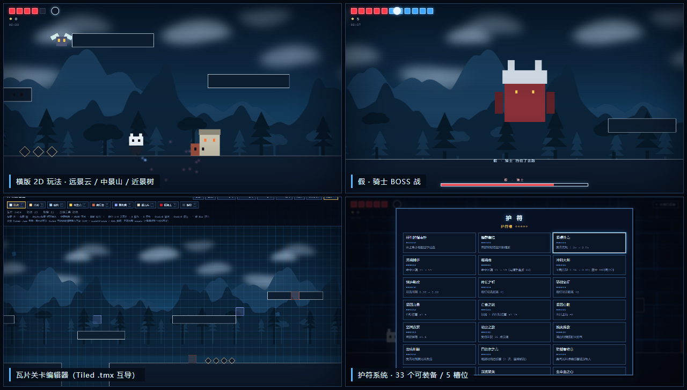

# 空洞骑士 · CUBE (hollow-knight-cube)

> 用 three.js 写的《空洞骑士》风格横版动作 DEMO。
> **纯 2D**（正交相机、零透视、全平面几何）、**零构建**（没有 npm / 打包器），双击 `index.html` 就能玩。



- 视觉参考：`[CUBE]横板动作游戏DEMO.mp4`（发光蓝砖、白色描边平台、积木式方块怪物）
- 主角造型参考：`player.png`（白色方头 + 双耳 + 黑方眼）
- three.js r149（UMD，`lib/three.min.js`，本地自带，离线可跑）

---

## 快速开始

```bash
# 方式一：直接双击 index.html（file:// 也能跑，全部资源都是本地的）
# 方式二：起个静态服务（推荐，方便调试 / 无头测试）
python -m http.server 8377      # 然后在浏览器打开 http://127.0.0.1:8377
```

浏览器需要 WebGL；手柄需要 [Gamepad API](https://developer.mozilla.org/docs/Web/API/Gamepad_API)（Chrome / Edge / Firefox 均可）。

---

## 操作

| 动作 | 键盘 | 手柄 | 触屏 |
| --- | --- | --- | --- |
| 移动 | `A` `D` | 左摇杆 / 十字键 | ◀ ▶ |
| 跳跃（可二段跳） | `W` / `空格` / `Z` | `A` | ▲ |
| 上劈 | 按住 `W` 再攻击 | 十字键上 / 摇杆上 + `X` | — |
| 空中下劈（踩怪反弹） | 按住 `S` 再攻击 | 十字键下 + `X` | — |
| 攻击（骨钉） | `X` / `J` | `X` / `LB` | ✦ |
| 冲刺 | `C` / `Shift` | `B` / `RB` / `RT` | ⇥ |
| 凝聚回血（长按） | `F` | `Y` / `LT` | — |
| 座椅互动 | `E` | `A` | — |
| 护符菜单 | `Tab` / `I` | `Back` | — |
| 暂停 | `P` / `Esc` | `Start` | — |
| 音效开关 | `M` | — | — |
| 关卡编辑器 | `` ` `` / `F2` | — | — |

- 护符菜单里手柄用**十字键选择 + `A` 装备**，`B` 返回。
- 手柄**没有按键事件**，游戏每帧轮询 `navigator.getGamepads()`（见 `src/gamepad.js`）；连接 / 断开也会弹出提示徽标。
- 震屏（受伤、砸地、咆哮）会同步触发手柄震动。

---

## 玩法

- **移动手感**：跑 / 二段跳 / 冲刺（带残影）/ 土狼时间 / 跳跃输入宽容
- **四向骨钉**：横劈向前、**上劈正上、下劈正下**（不带斜角）。横劈**命中敌人**时会被反推一下（后坐力），空中更明显；切中"稳定之体"护符可以取消
- **下劈反弹**：空中向下劈到敌人或尖刺会弹起来，并重置二段跳与冲刺
- **面具 / 灵魂**：初始 5 面具（护符可加到 7+）。命中敌人积攒灵魂（上限 99），长按 `F` 消耗 33 灵魂凝聚回 1 面具
- **吉欧**：击倒敌人掉落，**默认要身体碰到才捡**（会落到地形顶面），装备"蜂群集结"后自动飞向你
- **护符**：5 个槽位，39 个护符中 33 个已实装（详见下文）
- **敌人**：爬行虫（会掉头巡逻）、复仇蝇（靠近后追击）、躯壳兵（突刺）、**假 · 骑士**（跳劈 + 横扫，带血条）
- **座椅**：互动即回满面具 / 灵魂并作为重生点（部分护符效果也在座椅处生效）
- **结算**：击败假骑士进入结算界面，显示用时 / 击杀 / 死亡次数

---

## 目录结构

```
hollow-knight-cube/
├── index.html            # 唯一的页面：DOM 骨架 + 全部 CSS + 模块加载顺序
├── src/                  # 12 个模块（经典 <script>，无构建）
│   ├── core.js           #  1 常量 CFG / 共享状态 S / 工具 / WebAudio 合成音效
│   ├── scene.js          #  2 渲染器 / 正交相机 / 程序化贴图 / 模拟视差背景（云-山-树）
│   ├── world.js          #  3 瓦片关卡数据 / 地形重建(贪心矩形合并) / 碰撞 / 粒子 / 积木文字
│   ├── entities.js       #  4 骑士 / 敌人 / 吉欧 / 挥砍与残影特效
│   ├── input.js          #  5 键盘+触屏汇总 / 相机跟随 / 震屏 / 暂停
│   ├── gamepad.js        #  6 手柄轮询（连接、映射、菜单导航、震动）
│   ├── hud.js            #  7 面具 / 魂 / 吉欧 / 提示条 / 小地图
│   ├── charms.js         #  8 护符数据 + 派生数值（伤害/冷却/磁吸…）+ 护符实体
│   ├── combat.js         #  9 四向骨钉判定 / 敌人 AI / 玩家控制
│   ├── main.js           # 10 状态机(标题-游戏-死亡-胜利) / 固定步长主循环
│   ├── tmx.js            # 11 Tiled .tmx 解析与导出
│   └── editor.js         # 12 瓦片关卡编辑器
├── lib/three.min.js      # three.js r149（UMD）
├── level/                # 示例关卡：hollow-knight-level.tmx + tileset 图（可直接用 Tiled 打开）
└── docs/preview.png      # README 预览图
```

---

## 架构

### 零构建 + 全局命名空间

没有打包器，所有模块通过 `window.HK` 通信，加载顺序写在 `index.html` 里：

```
core → scene → world → entities → input → gamepad → hud → charms → combat → main → tmx → editor
```

- 跨模块可变的标量统一放 `HK.S`（`state` / `paused` / `editor` / `charmOpen` / `levelW` …）
- 对象与数组按引用共享（`HK.player` / `HK.enemies` / `HK.solids` …）
- 模块间循环依赖（`charms ↔ combat`、`combat → main`）用**运行时** `HK.foo()` 调用，不在加载期解构

> ⚠️ 用 `Object.assign(HK, { get x(){}, set x(v){} })` 暴露访问器会被**拍平成静态数据属性**（快照）。
> 需要实时读写的字段请用 `Object.defineProperty(HK, 'x', { get, set })` —— 见 `world.js` 的 `HK.tiles`、`editor.js` 的 `HK.editorOpen`。

### 纯 2D

- 相机是 `OrthographicCamera`，**固定可视高度 `CFG.VIEWH = 14` 世界单位**，宽度按窗口宽高比扩展 → 没有近大远小
- 所有几何是 `PlaneGeometry` / `CircleGeometry` / `RingGeometry` / `Sprite`，材质一律 `MeshBasicMaterial`（不吃光），场景里 **0 灯光、0 雾**
- 缩放走 `camera.zoom` + `updateProjectionMatrix()`（入口 `HK.setZoom()`），不是移动相机 z
- 角色靠 `scale.x = -1` 左右翻转，所以**所有角色材质必须 `side: DoubleSide`**（否则镜像后被背面剔除，整个人消失）

### 背景：手写的模拟视差

正交投影下**没有真实视差**（平行投影里不同深度的位移完全相同），所以背景视差是手动模拟的：

- **天空底**（z=-70）：一块竖直渐变板，完全跟着镜头 → 看起来无穷远
- **远景 · 云** k=0.12 → **中景 · 山** k=0.32 → **近景 · 树** k=0.62（z = -34 / -22 / -11）

每层是一块"钉在镜头上"的背景板，每帧把贴图**回卷 `k × 相机位移`**（`updateParallax()`）；`k = 0` 完全跟随镜头，`k = 1` 与世界同速。三层贴图都是运行时用 Canvas 2D 画出来的（云 = 椭圆 + 模糊，山 = 整数频率正弦叠加成山脊，树 = 两排剪影），**左右无缝**（每个形状都在 `x-W / x / x+W` 各画一遍）。

### 关卡：瓦片是唯一数据源

```js
HK.tiles = { "tx,ty": "solid" }   // 一格 = 1 世界单位
```

瓦片码表见 `world.js` 的 `TILE_INFO`：`solid` 砖块 / `spike` 尖刺 / `bench` 座椅 / `spawn` 出生点 / `crawler` / `fly` / `husk` / `boss`。

改完瓦片调 `HK.buildLevel(tiles)` 重建：先按码表分类，再用**贪心矩形合并**把同色相邻格合成大矩形（所以地形是几个大平面 + 白色描边，而不是几千个小方块），同时重建 `solids / plats / grounds / spikes / benches` 碰撞数据与刷怪表。

> 📐 锚点约定：`mergeRects()` 给的是**最小角**矩形，而 `hitRect()` 和所有实体用**底部中心**（`l = x-w/2, b = y`）。
> 地形入数组前一律过 `pushTerrain()` 换算，两种表示只有一个约定 —— 否则碰撞盒会整体错半个宽度（画在哪 ≠ 撞在哪）。

### 输入

键盘 / 触屏 / 手柄三种设备在 `input.js` 的 `pollInput()` 里汇总成**同一套语义**：

- `held`：持续按住（含 up/down 瞄准）
- `buffer`：按下瞬间，带输入宽容（跳跃 / 冲刺 / 攻击）

新设备只要往这两个对象里写，游戏逻辑一行都不用改。世界没在步进（暂停 / 护符菜单 / 编辑器 / 死亡界面）时必须清空 `buffer`，否则菜单里按的跳会留到关菜单的瞬间凭空起跳。

---

## 护符

5 个槽位，`charms.js` 里 39 条数据，其中 **33 个已实装**，6 个灰置（等法术 / 召唤 / 梦之钉 / 剑技等系统）：

| 已实装（33） | |
| --- | --- |
| 任性的指南针 · 蜂群集结 · 坚硬外壳 · 灵魂捕手 · 噬魂者 · 冲刺大师 · 快速劈砍 · 修长之钉 · 骄傲象征 · 坚固力量 · 亡者之怒 · 坚固心脏 · 坚固贪婪 · 幼虫之歌 · 蜕变挽歌 · 苦痛荆棘 · 巴德尔之壳 · 防御者纹章 | 快速聚集 · 深度聚集 · 生命血之心 · 生命血核心 · 蜂巢之血 · 蘑菇孢子 · 锋利之影 · 乌恩之形 · 编织者之歌 · 梦之盾 · 法术扭曲者 · 稳定之体 · 沉重之击 · 飞毛腿 · 国王之魂 |

| 灰置（待对应系统） | |
| --- | --- |
| 萨满之石 · 发光子宫 · 格林之子 · 舞梦人 · 骨钉大师的荣耀 · 乔尼祝福 | 需要法术 / 召唤 / 梦之钉 / 剑技 / 生命血转化系统 |

实现方式：数值类护符写成 `charms.js` 的派生函数（`nailDmg()` / `atkCDv()` / `dashCDv()` / `runV()` / `magnetRv()` …），战斗代码只问函数，不关心装了哪些护符；实体类护符（剑气 / 孢子云 / 幼体 / 梦盾 / 臭气光环）统一在 `charmUpdate()` 里每帧跑。伤害统一走 `damageEnemy()` 一个入口。

---

## 关卡编辑器

`` ` `` 或 `F2` 进出（进入时会收起所有覆盖层、隐藏玩家与敌人、显示网格与瓦片标记）。

| 操作 | 说明 |
| --- | --- |
| 左键 / 右键 | 涂 / 擦（可拖拽连续） |
| `Shift` + 左键 | 矩形填充 |
| 中键拖拽 / `WASD` | 平移 |
| 滚轮 | 缩放（用 `camera.zoom` 拉远拉近） |
| `1`–`8` / `9` | 选瓦片 / 擦除 |
| `G` / `Delete` | 网格 / 清空 |
| `Ctrl+Z` / `Ctrl+S` | 撤销（栈深 40） / 存到 localStorage |

工具条支持 **JSON 导出 / 导入**、**Tiled `.tmx` 导出 / 导入**、**默认关卡**、**一键测试 ▶**（拿当前瓦片直接开局）。

### .tmx 互导

`tmx.js` 做了完整的双向转换，导出后可以在 [Tiled](https://www.mapeditor.org/) 里继续编辑再导回来：

- **导出**：`tilewidth=tileheight=32`、内嵌 tileset（8 格）、每个 `<tile type="牌名">`、CSV 图层数据（**顶格写**，和 Tiled 自己的输出一致）、原点与关卡宽度写进 `<properties>` 保证往返无损
- **导入**：CSV / base64(zlib · gzip) / 裸 `<tile gid>` 三种数据、无限地图 `<chunk>`、多图层按顺序合并、对象层的矩形与点，gid 高位翻转标志位自动抹掉
- gid → 瓦片：先读 `<tile type/class>`，再读 tile 属性（type/code/hk/kind），再读 `name`，最后按 tileset 顺序回退；内置中英文别名（`ground/floor/wall → solid`、`hazard → spike`、`start/player → spawn` …）

`level/` 里放了一份导出好的示例（`.tmx` + `hollow_knight_tiles.png`），直接拖进 Tiled 就能打开。

---

## 调试与回归测试

所有调试入口都挂在 `window.HK` 上，浏览器控制台里可以直接读写：

```js
HK.startGame()                 // 直接开局
HK.player.x = 110              // 传送
HK.enemies.length              // 场上敌人
HK.tiles                       // 当前关卡瓦片（改完调 HK.buildLevel(HK.tiles)）
HK.equipped.add('steady')      // 装备护符
HK.viewSize() / HK.setZoom(2)  // 当前可视尺寸 / 缩放
```

无头回归测试用 `playwright-core` + 系统 Edge（`channel: 'msedge'`）驱动本地服务，覆盖：

| 脚本 | 覆盖 |
| --- | --- |
| `test-modules` | 拆模块后全流程：开局 → 跑跳攻击 → 回血 → Boss → 胜利 → 死亡重生 |
| `test-death` / `test-charm` | 死亡重生、护符装备与各类护符效果 |
| `test-editor` / `test-editor2` | 编辑器绘制 / 撤销 / 存取 / 关卡往返 / 敌人不膨胀 |
| `test-tmx` | `.tmx` 往返无损、多种数据编码、对象层 |
| `test-flat2d` / `test-bg` | 纯 2D 结构审计（0 灯光 / 0 方块几何）、无透视的数学证明、视差速率、贴图无缝 |
| `test-align` | 视觉盒 ≡ 碰撞盒、每格实地都被覆盖、悬崖掉头位置 |
| `test-gamepad` | 注入假手柄，端到端验证连接 / 移动 / 死区 / 跳 / 攻击 / 冲刺 / 菜单导航 / 震动 |
| `test-recoil-geo` / `test-slash-dir` | 命中后坐力、吉欧拾取与磁吸、上下劈方向与判定盒 |
| `shot-*.js` | 截图（对照图 + 玩法/Boss/护符/编辑器预览） |

---

## 还没做

- 法术系统（尖啸 / 俯冲 / 波）、骨钉剑技、梦之钉 —— 对应 6 个灰置护符
- 音效是 WebAudio 合成的（零外部资源），只有音效没有 BGM
- 只有一个关卡与一只 Boss

---

## 许可

[MIT](LICENSE) © 2026 Mondeville

《空洞骑士》(Hollow Knight) 是 Team Cherry 的商标与版权作品，本项目仅作技术学习用的非商业复刻 DEMO。
